<p align="center">
  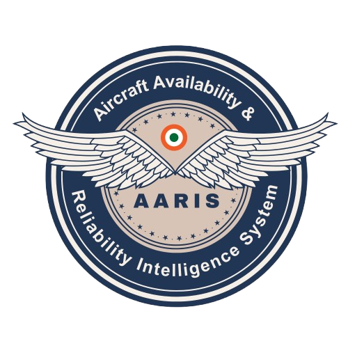
</p>

<h1 align="center">AARIS — Aircraft Availability & Reliability Intelligence System</h1>

<p align="center">
  <strong>Jet-engine health prediction at the edge, fleet readiness at the base, and a solver that decides who enters the hangar next.</strong>
</p>

<p align="center">
  <a href="#what-it-does">What it does</a> •
  <a href="#screenshots">Screenshots</a> •
  <a href="#architecture">Architecture</a> •
  <a href="#quick-start">Quick start</a> •
  <a href="#the-model">The model</a> •
  <a href="#verification">Verification</a> •
  <a href="#references">References</a>
</p>

<p align="center">
  
  
  
  
  
</p>

> **Demonstration data only.** AARIS runs on a synthetic 90-aircraft roster.
> No real IAF (or any air force) maintenance records, tail numbers, sortie
> data, defect reports or classified material are used, stored, scraped or
> implied anywhere in this repository. Aircraft identities, bases,
> maintenance dates and issue logs are generated by `ground/make_profiles.py`
> and `ground/seed_demo.py`, and the type photos in the dashboard are
> labelled illustrative images of the *type*, never of a specific airframe.

---

## What it does

Three questions, answered by three services:

1. **"How many cycles before this engine needs work?"** — an **edge node**
   (`edge/`) that would sit on the aircraft's onboard processor takes a raw
   30-cycle window of 24 engine sensor channels and returns Remaining Useful
   Life (RUL) in cycles, an engine-health %, a risk band, a **conformal
   uncertainty interval**, and the sensors that drove the prediction.
2. **"So what is my fleet's status right now?"** — a **ground station**
   (`ground/`) stores every health report in SQLite, keeps the latest state
   per aircraft, raises and clears critical alerts automatically, protects
   everything with JWT roles and per-aircraft device tokens, and records an
   audit trail of every access.
3. **"Who enters the hangar next, and when?"** — a **CP-SAT optimiser**
   (`ground/scheduler.py`) turns current fleet health into a 30-day
   maintenance plan under daily hangar capacity, per-aircraft deadlines
   derived from RUL, mission priority and spare-part lead time. Every aircraft
   ends up either SCHEDULED (with a day and a reason) or DEFERRED (with an
   explicit reason).

A **Streamlit dashboard** (`dashboard/`) ties it together for a commander:
one headline Fleet Availability number, per-aircraft and per-type profiles,
the critical-alert queue, and the plan as a Gantt chart. It also has a
**DEMO MODE** backed by a captured snapshot, so the whole story survives the
API being down — or being demonstrated away from the stack.

**Scale of the demo:** 6 aircraft types × 15 airframes = **90 aircraft**
(Rafale EH, Su-30MKI, Tejas Mk1A, MiG-29UPG, Mirage 2000/TI, Jaguar IS/IM),
390 stored health reports, 18 grounded airframes, plan **OPTIMAL:
54 scheduled / 36 deferred** at 8 tasks/day.

---

## Screenshots

Real captures of the running stack (see
[`docs/screenshots/README.md`](docs/screenshots/README.md) for how to
regenerate them). Numbers shown are the fresh-demo baseline.

| Sign in | Fleet readiness | Critical alerts |
| --- | --- | --- |
| 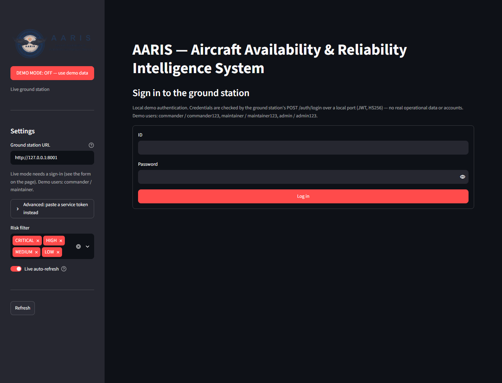 | 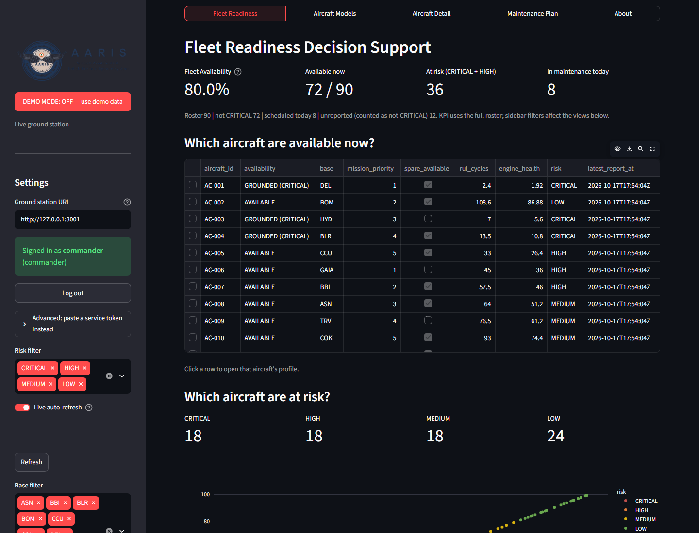 | 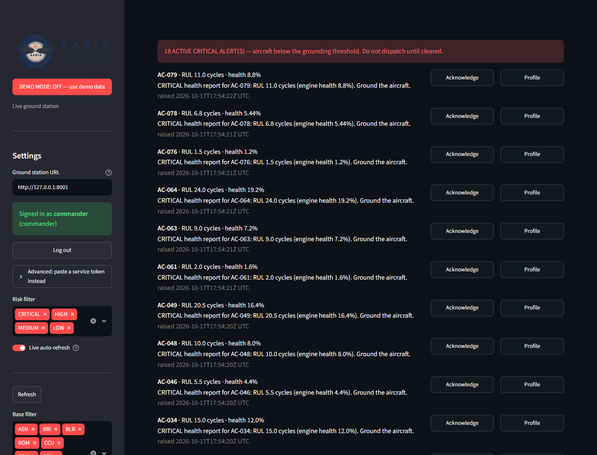 |

| Aircraft types | Airframe roster per type | Aircraft profile |
| --- | --- | --- |
| 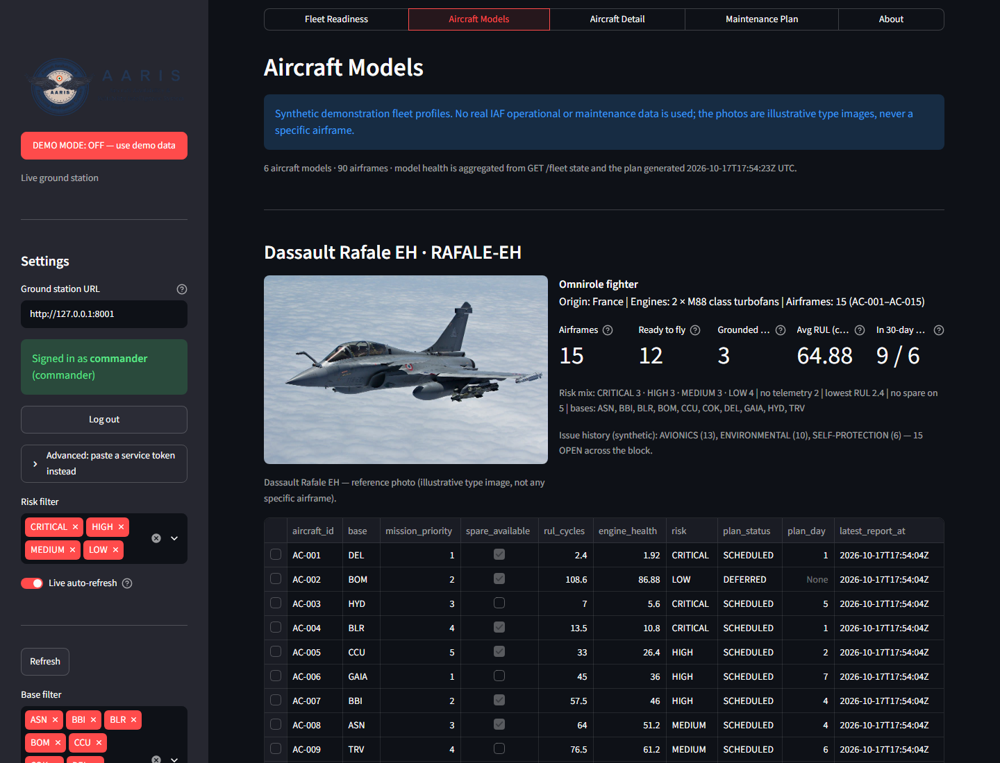 | 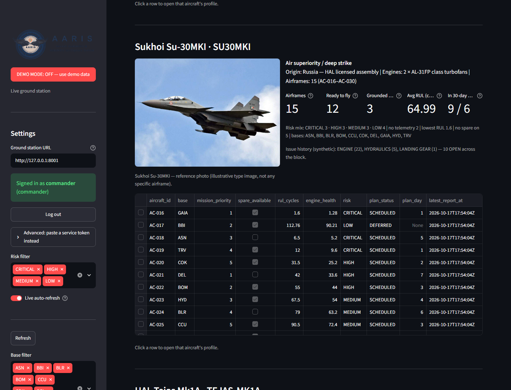 | 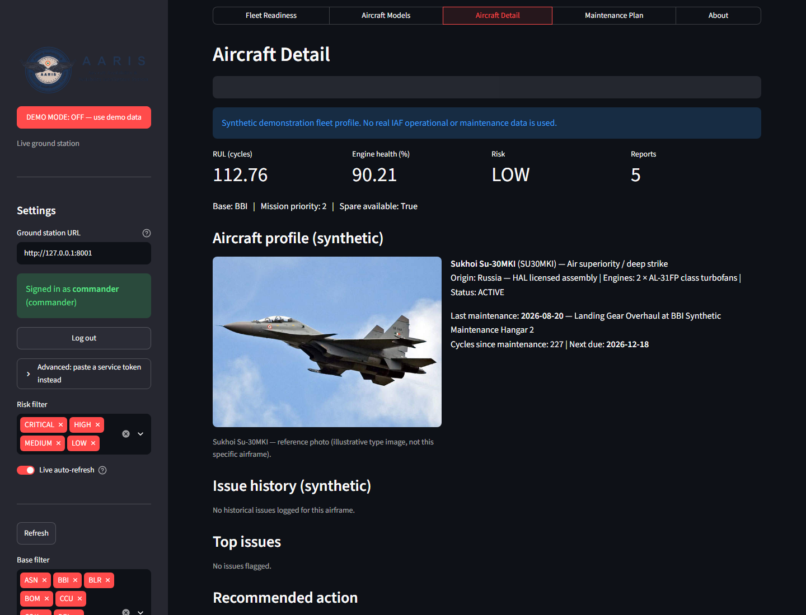 |

| Maintenance plan | How it works | Edge API | Ground API |
| --- | --- | --- | --- |
| 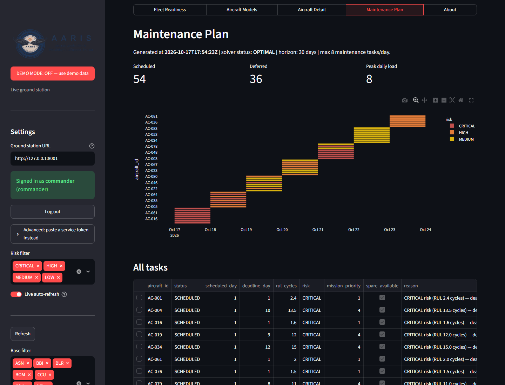 | 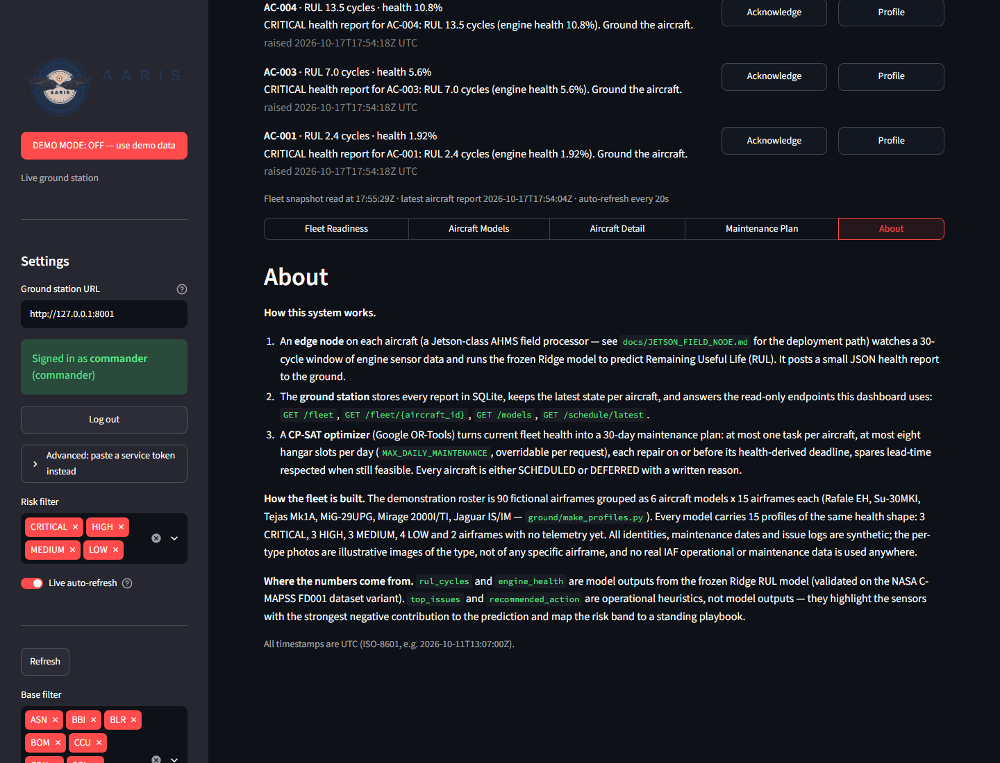 | 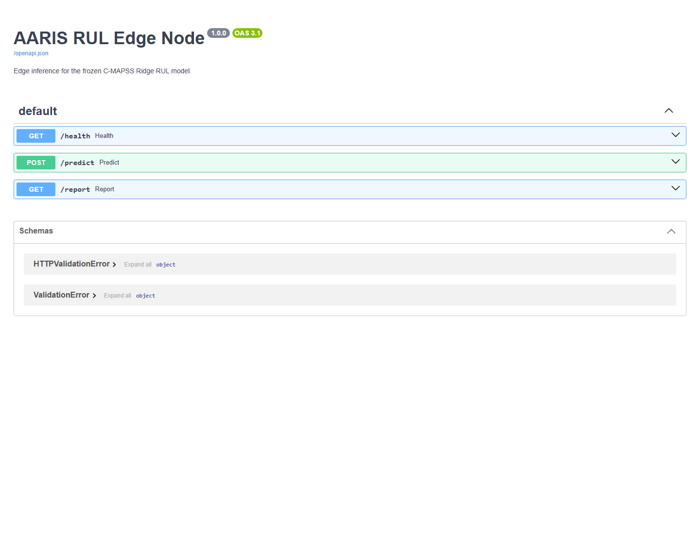 | 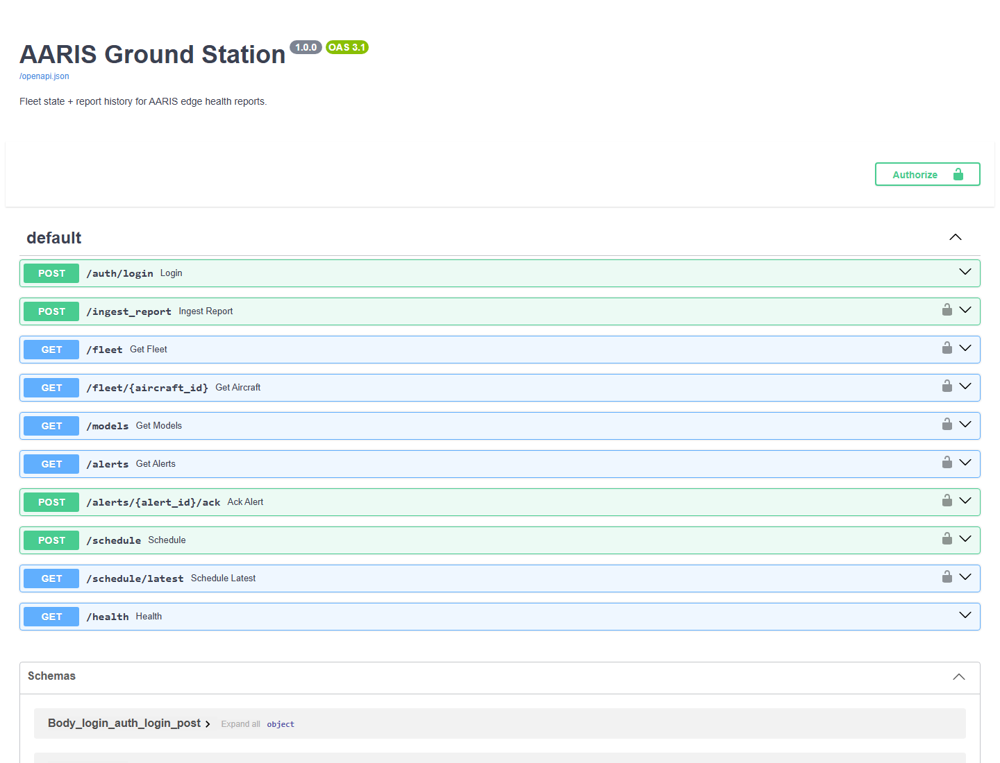 |

---

## Architecture

```mermaid
flowchart LR
    subgraph EDGE["On the aircraft — edge node, port 8000"]
        S[30-cycle sensor window<br/>21 sensors + 3 op settings] --> R[Frozen Ridge RUL model<br/>scale, flatten, predict, clip to 125]
        R --> C[Cross-conformal sidecar<br/>90 percent interval, half-width 27.19 cycles]
        C --> P[POST /predict<br/>RUL, health, risk band,<br/>interval, top issues, action]
    end

    subgraph BASE["At the base — ground station, port 8001"]
        I[POST /ingest_report<br/>device token, own aircraft only] --> DB[(SQLite ground/fleet.db<br/>aircraft, reports,<br/>alerts, plans, audit logs)]
        DB --> AL[Alert lifecycle<br/>ACTIVE, ACKNOWLEDGED, CLEARED]
        DB --> SCH[POST /schedule — CP-SAT<br/>30-day horizon, 8 tasks per day,<br/>deadline floor of 0.8 x RUL]
        SCH --> PL[Plan output<br/>SCHEDULED day plus reason,<br/>or DEFERRED plus reason]
        DB --> API[Read API behind JWT RBAC<br/>/fleet, /models, /alerts,<br/>/schedule/latest, /health]
    end

    subgraph OPS["Operator — Streamlit dashboard, port 8501"]
        DASH[Five sections<br/>Fleet Readiness, Aircraft Models,<br/>Aircraft Detail, Maintenance Plan, About] --> Q[Fleet Availability KPI, grounded list,<br/>type profiles, Gantt plan, deferral reasons]
    end

    P -->|signed health report| I
    API -->|commander or maintainer JWT| DASH
    PL --> API
    AL --> DASH
```

**Data flow in one line:** sensors → edge RUL + interval → signed health
report → SQLite → (alerts, CP-SAT plan, read API) → dashboard.

**Failure isolation is deliberate.** The edge node holds only frozen
inference artifacts (~6 KB of pickles plus a sample window) and never needs
the ground; the ground never calls the edge; the dashboard degrades to a
captured snapshot (DEMO MODE) when the ground is unreachable. A crashed
aircraft node cannot corrupt base data — it can only fail to report, which
the ground surfaces as "no telemetry" rather than guessing.

### The three services

| Service | Path | Entrypoint | Owns |
| --- | --- | --- | --- |
| Edge node | `edge/` | `edge_node.py` (FastAPI, :8000) | Frozen Ridge model + scaler + feature order, conformal sidecar, `/predict`, `/report`, `/health` |
| Ground station | `ground/` | `ground_station.py` (FastAPI, :8001) | SQLite schema, ingest + history, alert lifecycle, JWT/RBAC + device tokens, audit log, CP-SAT scheduler, model/aircraft profiles |
| Dashboard | `dashboard/` | `app.py` (Streamlit, :8501) | Login, live/DEMO data access, risk & base filters, KPI, type + airframe views, plan views, 20 s auto-refresh |

Supporting parts: `src/`, `main.py`, `experiments/` — the upstream
Transformer/RUL research code and the audit experiments; `conformal/` — the
calibration artifact the edge node ships with; `demo/` — one-command demo
launcher, end-to-end verifier, screenshot and snapshot capture; `docs/` —
reports, the Jetson deployment path, screenshots.

---

## Quick start

Windows is the reference environment (`start.bat` / `stop.bat`); everything is
plain Python, so the manual commands work on Linux/macOS too.

```bat
:: 1. create the environment
python -m venv .venv
.venv\Scripts\python.exe -m pip install -r requirements.txt
.venv\Scripts\python.exe -m pip install -r ground\requirements.txt

:: 2. start all three services (edge :8000, ground :8001, dashboard :8501)
start.bat

:: 3. open the dashboard, sign in, look around
::    http://localhost:8501     commander / commander123
::                             maintainer / maintainer123   (can run the plan)
::                             admin      / admin123

:: 4. shut everything down
stop.bat
```

**Rehearse a full demo from an empty database** (seeds the 90-aircraft fleet,
ingests 390 reports, generates the CP-SAT plan, opens the stack):

```powershell
powershell -ExecutionPolicy Bypass -File demo\run_demo.ps1 -Reset -NoBrowser
```

Useful variants:

```bat
start.bat --live-feed      :: AC-017 streams synthetic reports (compressed cadence)
                           ::   so a CRITICAL alert appears within ~2-3 minutes
start.bat --fleet-feed     :: one feed per airframe (AC-001..AC-090), each using
                           ::   its own device token, staggered
```

Optional: the NASA C-MAPSS FD001 files are **not** committed (44 MB of public
data). Put `train_FD001.txt`, `test_FD001.txt` and `RUL_FD001.txt` in
`Dataset/` only if you want to retrain or re-validate the model — the running
demo needs nothing from there, because the edge node ships frozen artifacts.

---

## API and access control

**Edge node (:8000)** — no auth; it is the aircraft's own processor.

| Method | Path | Purpose |
| --- | --- | --- |
| `GET` | `/health` | Model + scaler loaded, feature order, artifact hashes |
| `POST` | `/predict` | 30×24 window → RUL, health %, risk band, conformal interval, top contributing sensors, recommended action |
| `GET` | `/report` | The last locally produced report (for a reconnecting link) |

Malformed windows are rejected with `422` (wrong shape, non-numeric, NaN/Inf,
too few rows) rather than being silently scored.

**Ground station (:8001)** — deny-by-default; `POST /auth/login` first.

| Method | Path | Allowed roles |
| --- | --- | --- |
| `POST` | `/auth/login` | public (OAuth2 form) |
| `POST` | `/ingest_report` | `edge_device` (own aircraft only), `admin` |
| `GET` | `/fleet`, `/fleet/{id}`, `/models`, `/alerts`, `/schedule/latest` | `maintenance_officer`, `commander`, `admin` |
| `POST` | `/alerts/{id}/ack` | `maintenance_officer`, `commander`, `admin` |
| `POST` | `/schedule` | `maintenance_officer`, `admin` — **not** `commander` |
| `GET` | `/health` | public (liveness only) |

Roles are demo accounts in `ground/security.py`: `maintainer` →
`maintenance_officer`, `commander` → `commander`, `admin` → `admin`, plus one
static device token per airframe (`edge-ac###-dev-token`). A device token used
for another aircraft returns `403`; unauthenticated reads return `401`. Every
login, denial, ingest, view and scheduling call lands in `audit_logs` — with
no tokens, passwords or raw payloads recorded (asserted by the test suite).

**Scheduling rules** (`ground/scheduler.py`, deterministic: 1 worker, seed 7,
so two solves are byte-identical):

- horizon 30 days, at most one task per aircraft, at most
  `MAX_DAILY_MAINTENANCE = 8` tasks/day (overridable per request, validated);
- deadline per aircraft = `max(1, min(30, floor(RUL × 0.8)))` — a CRITICAL
  airframe's deadline can be day 1, and the solver will not book it late;
- aircraft with no spare on hand cannot be serviced before day
  `SPARE_LEAD_DAYS = 5`; treated as a hard constraint when that still allows
  everyone to be served, otherwise a documented soft trade-off in the reason;
- objective weights urgency, risk and mission priority against scheduled day,
  plus deferral penalties;
- outcome on the seeded fleet: **OPTIMAL, 54 scheduled / 36 deferred**, peak
  load exactly 8/day (days 1-7), AC-001 (RUL 2.4) on day 1 = its deadline,
  no-spare AC-003 held to day 5, 12 airframes deferred for missing telemetry.

---

## The model

The edge node scores RUL with a **frozen Ridge regression** on the flattened
30×24 sensor window (`MinMaxScaler` → flatten → `Ridge(alpha=10)` → clip to
`[0, 125]`), trained on NASA C-MAPSS **FD001**. It is frozen deliberately:
byte-identical artifacts in `edge/models/ridge_model/` and
`results/ridge_model/` (SHA-256 verified), inference-only, never retrained at
runtime.

Measured on this repository's FD001 variant (100 test engines, identical
split, scaler, windows and metric code for every row):

| Model | Test RMSE | MAE | NASA score (PHM08 standard) |
| --- | --- | --- | --- |
| Constant-mean predictor | 41.89 | 36.14 | 19,054 |
| Constant-38 predictor (the original collapsed behaviour) | 55.99 | 47.76 | 30,201 |
| **Ridge on flattened window — deployed at the edge** | **16.22** | 13.21 | **413** |
| 1-layer LSTM (h=64, 30 epochs) | 17.65 | 12.54 | 425 |
| Transformer, seeds 42 / 43 / 44 | 18.76 / 19.21 / 17.42 (mean 18.46 ± 0.76) | mean 13.71 | 544 / 800 / 608 |

**Honest reading of that table.** The demonstrable win is over the broken
starting state (test RMSE **55.30 → 18.46 ± 0.76**, predictions going from one
constant value to a full spread with 0.899 correlation to truth). The
Transformer matches or beats the LSTM but **does not beat a plain Ridge
regression on this dataset variant** — under both truth conventions (Ridge
16.22 vs 14.88 capped-truth). So the deployed edge model is the Ridge, chosen
on measured accuracy and its ~6 KB artifact (model + scaler + feature order),
not on architecture fashion. Full detail: [`RESULTS.md`](RESULTS.md).

**Uncertainty is separate and calibrated.** `conformal/risk_calibration.json`
comes from a cross-conformal run on the frozen recipe (engine-wise
GroupKFold k=5, per-fold scaler and Ridge refit, 17,731 out-of-fold windows
from 100 engines; OOF RMSE 16.41, MAE 13.2). Residual quantiles give
half-widths of **21.81 / 27.19 / 31.32 cycles** at 80 / 90 / 95 %, with
measured out-of-fold coverage **0.8001 / 0.9001 / 0.9501** — the interval
means what it says. Per risk band at 90 %: LOW 96.8 %, MEDIUM 76.3 %, HIGH
97.5 %, CRITICAL 100 %, so the dashboard can say honestly where the global
interval is conservative and where it is thin. Of the windows the point
estimate calls CRITICAL, 97.9 % truly are below 30 cycles, and for 59.9 % the
90 % upper bound also stays below the grounding threshold — the edge node
reports which side of that line a given reading is on instead of hiding it.

**What the audit found and fixed** (full write-up in
[`docs/AUDIT_AND_IMPROVEMENTS.md`](docs/AUDIT_AND_IMPROVEMENTS.md)):

1. **Label/target bugs** — unscaled 0-125 targets against scaled features
   (gradient norms ~1600, so clipping crushed every step), an asymmetric loss
   whose `LAMBDA_OVER = 10` made a constant 38 the optimal degenerate answer,
   and windows paired with the RUL of the row *after* the window. Fixed;
   verified by rebuilding sequences independently.
2. **NASA score implemented with the penalty scales swapped** — it punished
   safety-conservative early predictions and rewarded dangerous late ones.
   Fixed and re-verified two ways; that is why the scores above are the
   standard-convention ones (Ridge 444 → **413**, seed-42 1,130 → 544).
3. **Validation split leaked** — window-level splitting put cycles from the
   same engine in train and validation. Rebuilt engine-wise: 4 configs × 3
   seeds = **12/12 leak-free runs** (`experiments/engine_split.py`), which
   flipped the conclusion: the `no_pe` variant that looked 4.92 RMSE better
   under the leak **loses at every seed** without it, and only `seq50` beats
   control at all three. Those figures are validation-only — the test set was
   deliberately not touched for the ablation.
4. **Dataset caveat** — this `Dataset/` is not the standard public FD001
   release: 100 test engines (not 21) with uncapped ground-truth RUL up to 145
   against a 125 cap. Results here are therefore **not comparable to published
   21-engine FD001 numbers**, and both truth conventions are reported side by
   side rather than the flattering one.

Risk bands map RUL to fleet-ops language: `LOW ≥ 100`, `MEDIUM 60-99`,
`HIGH 30-59`, `CRITICAL < 30` cycles (grounding threshold 30).
`top_issues` / `recommended_action` are operational heuristics over the
model's sensor contributions — the dashboard labels them as such rather than
presenting them as model output.

---

## Verification

Four suites, all green against the current state (2026-10-17):

```bat
.venv\Scripts\python.exe edge\smoke_test.py            :: frozen inference + 422 guards + conformal
.venv\Scripts\python.exe ground\smoke_test.py          :: RBAC matrix, ingest binding, alerts, CP-SAT, audit, persistence
.venv\Scripts\python.exe dashboard\app_tests.py        :: 10 AppTest checks incl. DEMO MODE offline and row-click -> profile
.venv\Scripts\python.exe demo\verify_pipeline.py       :: 13 end-to-end checks against the live stack
```

What they pin down, among other things:

- `POST /predict` on the real fixture returns **112.76 cycles / 90.21 % / LOW**
  for AC-017 — the frozen-model regression tripwire, and the same value the
  dashboard shows for that airframe;
- a device token cannot report for another aircraft (`403`), a commander
  cannot run the scheduler (`403`), no credentials means `401` everywhere;
- CRITICAL ingest raises exactly one ACTIVE alert per airframe, a repeat
  refreshes rather than stacks it, and a later healthy reading **auto-clears**
  it — the invariant "ACTIVE alerts == the CRITICAL set" is asserted;
- the plan respects capacity (no day above 8), deadlines, spare lead times,
  covers all 90 airframes exactly once, is deterministic across solves and
  survives a service restart;
- `GET /models` aggregates match `GET /fleet` per type (6 × 15, 3 CRITICAL
  each), and the audit log contains no secrets;
- DEMO MODE renders the full story with **zero network calls** (the test
  patches `requests.get` to raise), and the Fleet Availability KPI is asserted
  against an independently recomputed value for the current plan day — not a
  hardcoded percentage, because the KPI legitimately moves as the plan ages
  (80.0 % on a fresh day 1, 71.1 % six days later when healthy airframes are
  in the hangar).

---

## Where each number comes from

| Claim | Source of truth |
| --- | --- |
| 90 aircraft, 6 types × 15, 18/18/18/24 risk mix, 12 unreported | `ground/fleet_config.json`, `ground/seed_demo.py`, `GET /fleet` |
| Type profiles, bases, issue histories, photos | `ground/make_profiles.py` → `ground/aircraft_profiles.json` (synthetic) |
| OPTIMAL, 54/36, peak 8/day, AC-001 day 1, AC-003 day 5 | `POST /schedule` → `GET /schedule/latest`, `ground/scheduler.py` |
| Fleet Availability KPI | `dashboard/app.py::compute_readiness`, live from `GET /fleet` + `GET /schedule/latest` |
| RUL 112.76 / 90.21 % / LOW, 90 % interval [85.57, 125.0] (shown as 85.6–125.0) | `edge/models/ridge_model/` + `conformal/risk_calibration.json` |
| RMSE / MAE / NASA score table | `results/baselines.json`, `results/nasa_audit.json`, `results/capped_truth_metrics.json`, `RESULTS.md` |
| 12-run leak-free ablation | `experiments/engine_split.py` → `results/engine_split/summary.json` |
| Screenshots | `demo/capture_screenshots.py` driving headless Chrome against the live stack |

Deeper reading: [`docs/PROJECT_REPORT.md`](docs/PROJECT_REPORT.md) (concise
project report), [`docs/DETAILED_WORK_REPORT.md`](docs/DETAILED_WORK_REPORT.md)
(work-by-work account with the evidence table),
[`docs/AUDIT_AND_IMPROVEMENTS.md`](docs/AUDIT_AND_IMPROVEMENTS.md) (what was
wrong and how it was proven fixed),
[`docs/JETSON_FIELD_NODE.md`](docs/JETSON_FIELD_NODE.md) (running the edge node
on a Jetson-class field processor, including the LAN/offline behaviour),
[`demo/demo_script.md`](demo/demo_script.md) (a walkthrough for presenting it).

---

## Repository layout

```
AARIS/
├── edge/                     Aircraft-side inference node (FastAPI, :8000)
│   ├── edge_node.py            /health /predict /report, risk bands, 422 guards
│   ├── live_reporter.py        synthetic live feed (--fast --ramp, --fleet)
│   ├── models/ridge_model/     FROZEN artifacts: model, scaler, feature order, fixture
│   └── smoke_test.py
├── ground/                   Base station (FastAPI + SQLite, :8001)
│   ├── ground_station.py       schema, ingest, alerts, read API, audit
│   ├── scheduler.py            CP-SAT 30-day maintenance plan
│   ├── security.py             JWT roles, device-token binding, audit helpers
│   ├── seed_demo.py            90-aircraft demo state (390 reports, 18 alerts)
│   ├── make_profiles.py        synthetic type + airframe profiles
│   ├── fleet_config.json       the roster (aircraft, bases, tokens)
│   ├── aircraft_profiles.json  per-airframe and per-type identities
│   └── smoke_test.py
├── dashboard/                Operator UI (Streamlit, :8501)
│   ├── app.py                  5 sections, RBAC login, DEMO MODE, auto-refresh
│   ├── demo_data.json          captured snapshot that makes DEMO MODE offline-capable
│   ├── assets/                 AARIS logo + illustrative type photos
│   └── app_tests.py
├── demo/                     Rehearsal and evidence tooling
│   ├── run_demo.ps1            one-command reset + seed + plan + start
│   ├── verify_pipeline.py      13 end-to-end checks
│   ├── capture_demo_data.py    refresh dashboard/demo_data.json from the live stack
│   ├── capture_screenshots.py  regenerate docs/screenshots/*.png
│   └── jetson_smoke.py         field-node link test against a base station
├── src/ main.py experiments/  Upstream research code: Transformer, baselines,
│                               conformal calibration, NASA-score audit, ablations
├── conformal/                risk_calibration.json + how it was produced
├── results/                  Small evidence artifacts (metrics JSON, run logs,
│                               ridge_model/ copy the edge artifacts are checked against)
├── outputs/                  Transformer plots and predictions (checkpoints ignored)
├── docs/                     Reports, Jetson deployment path, screenshots, upstream README
├── Dataset/                  (not committed) NASA C-MAPSS FD001 text files
├── start.bat / stop.bat        Launch and shut down all three services
├── requirements.txt            Research/training stack (torch, sklearn, pandas, …)
├── ground/requirements.txt     Service stack (fastapi, uvicorn, ortools, pyjwt, …)
└── .env.example                Security settings to change before any real use
```

---

## Security notes for anyone who takes this past a demo

The demo defaults are intentionally convenient and loudly flagged as unsafe:
`ground/security.py` warns when `AEROGUARD_SECRET_KEY` is unset and uses an
insecure dev key, and the ground station logs that 90 device tokens are the
guessable `edge-ac###-dev-token` defaults. Before any real deployment: set a
real JWT secret, set one `EDGE_<AIRCRAFT>_TOKEN` per physical device (they are
read from `.env`, see `.env.example`), bind the ground station behind TLS and
a network policy (`GROUND_HOST=0.0.0.0` is only for a LAN demo), and replace
the SHA-256 demo passwords with a real user store. There is no real
operational data anywhere in here to protect — that is deliberate.

---

## References

**Upstream research code this project builds on**

- Muhammad Usman — *NASA C-MAPSS Transformer-Based RUL Prediction*, MIT
  licence. Source repository for `src/`, `main.py` and the FD001 pipeline:
  <https://github.com/Usman67728/NASA-C-MAPSS_Transformer_Based_Analysis>
  (the original README is preserved as
  [`docs/UPSTREAM_README.md`](docs/UPSTREAM_README.md)).

**Dataset**

- Saxena, A., Goebel, K., Simon, D., Eklund, N. — *Damage Propagation Modeling
  for Aircraft Engine Run-to-Failure Simulation*, PHM08 Challenge Dataset,
  NASA. <https://data.nasa.gov/Aerospace/CMAPSS-Jet-Engine-Simulated-Data/ff5v-kuh6>
  (local variant documented in `Dataset/readme.txt`).

**Methods and papers**

- Vaswani, A., et al. — *Attention is all you need*, NeurIPS 2017 (architecture
  used in `src/models/transformer.py`).
- Li, X., et al. — *Remaining useful life estimation in prognostics using deep
  convolution neural networks*, Reliability Engineering & System Safety 2018
  (the `MAX_RUL = 125` piecewise-cap convention).
- Saxena, A., et al. — PHM08 *NASA score* definition (the metric audited and
  corrected in `src/models/loss.py`).
- Angelopoulos, A., et al. — conformal prediction for regression
  (split / cross-conformal approach behind `conformal/risk_calibration.json`).
- Google OR-Tools — CP-SAT solver reference for `ground/scheduler.py`.

**Open-source projects surveyed while designing the fleet layer** (documented
in `docs/AUDIT_AND_IMPROVEMENTS.md`; none vendored into this repo): MAPIE and
PyOD (conformal / anomaly tooling), `rul_codes_open` and `rul-datasets`
(C-MAPSS baselines and loaders), the GNN RUL benchmark (arXiv:2409.19629),
`Adaptive-Graph-CNN` and `bayesrul` (graph/Bayesian RUL), and
`aero_phm_kgqa_manager` (PHM knowledge graphs).

**Dependencies** — see [`requirements.txt`](requirements.txt) (torch, numpy,
pandas, scikit-learn, matplotlib, seaborn, scipy) and
[`ground/requirements.txt`](ground/requirements.txt) (FastAPI, uvicorn,
pydantic, ortools, PyJWT, python-multipart). SQLite comes from the standard
library, so the ground station has no database driver to install.

---

## Licence

MIT — see [LICENSE](LICENSE). The upstream Transformer code it derives from is
also MIT-licensed (see `docs/UPSTREAM_README.md`); attribution is retained
above and in the source headers.

```bibtex
@software{aaris_fleet_health_2026,
  author = {Aaditya Joshi},
  title  = {AARIS: Aircraft Availability and Reliability Intelligence System},
  year   = {2026},
  url    = {https://github.com/aadityajoshi01/AARIS-Aircraft-Availability-and-Reliability-Intelligence-Systemz},
  note   = {C-MAPSS RUL edge inference, ground station and CP-SAT maintenance scheduling; builds on NASA-C-MAPSS_Transformer_Based_Analysis (Muhammad Usman, MIT)}
}
```
